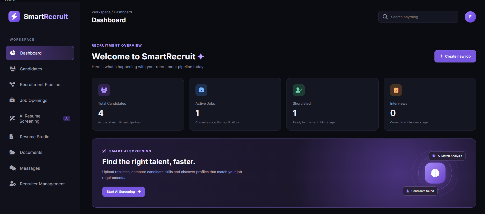
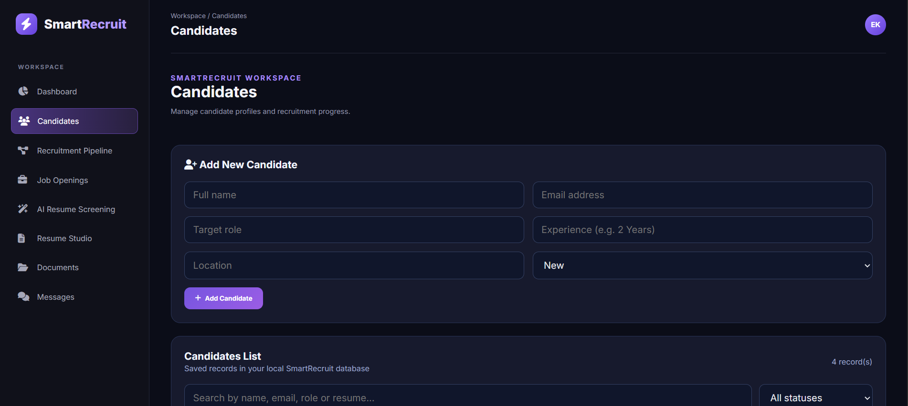
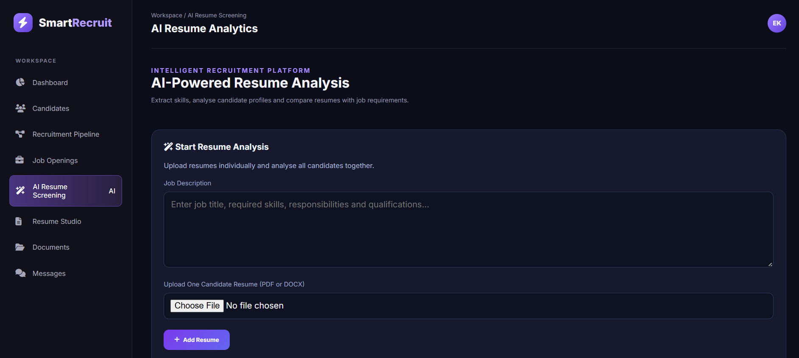
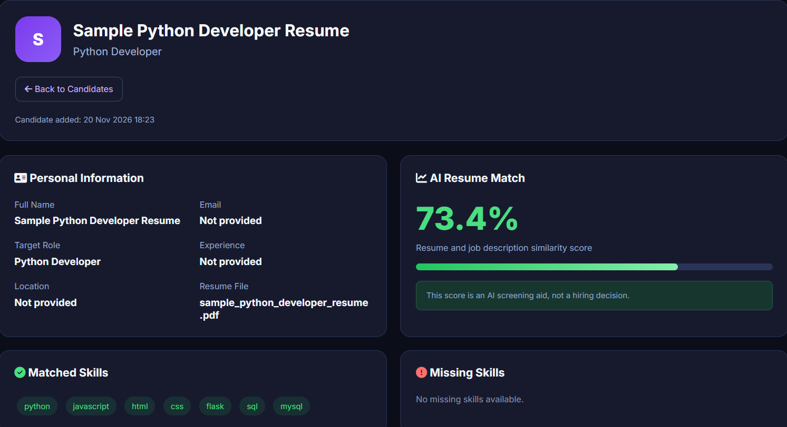
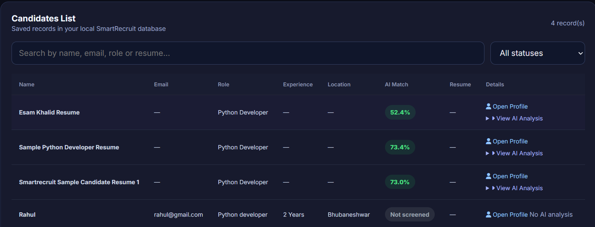
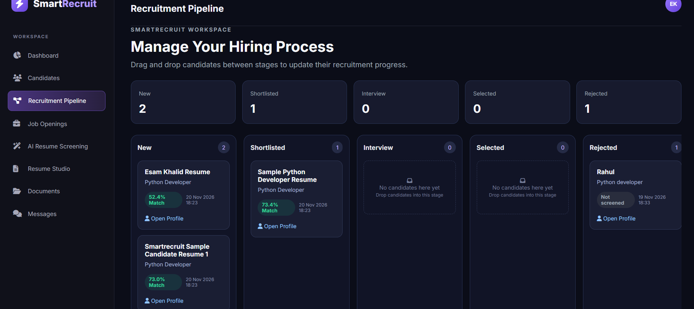

# ⚡ SmartRecruit – AI-Powered Recruitment Management System

**SmartRecruit** is an AI-powered recruitment management system developed using Python and Flask. It helps recruiters manage candidates, track recruitment progress, organize job openings, and analyse resumes against job descriptions.

The platform combines recruitment management tools with AI-based resume screening to make the hiring workflow more organized and efficient.

---

## 🚀 Features

### 1. Dashboard
- View total candidates.
- Monitor active job openings.
- Track shortlisted candidates.
- Monitor interview progress.
- Access recruitment modules from one dashboard.

### 2. Candidate Management
- Add and manage candidate profiles.
- Store candidate information such as name, email, target role, experience, and location.
- Search and filter candidates.
- View detailed candidate profiles.
- Track candidate recruitment status.

### 3. AI Resume Screening
- Upload resumes in PDF and DOCX formats.
- Enter job descriptions and required qualifications.
- Analyse resumes against job requirements.
- Generate resume similarity scores.
- Identify matched and missing skills where available.
- Compare candidate profiles to support recruiter decisions.

### 4. Recruitment Pipeline
- Track candidate recruitment progress.
- Organize candidates according to their hiring stages.

### 5. Job Openings
- Manage recruitment opportunities.
- Track active job openings.

### 6. Resume Studio
- Access resume-related tools within the recruitment workspace.

### 7. Document Management
- Organize recruitment-related documents.

### 8. Recruiter Management
- Secure recruiter login and authentication.
- Role-based access for administrators and recruiters.
- Admin functionality to manage recruiter accounts.

### 9. Messaging
- Access the messaging module for recruitment communication.

---

## 🛠️ Technology Stack

| Technology | Purpose |
|---|---|
| Python | Backend programming |
| Flask | Web application framework |
| SQLite | Database management |
| HTML5 | Frontend structure |
| CSS3 | Styling and responsive interface |
| JavaScript | Frontend interactions |
| Sentence Transformers | Semantic resume matching |
| Scikit-learn | Text similarity and analysis |
| PyMuPDF | PDF text extraction |
| python-docx | DOCX text extraction |

---


## 📸 Application Screenshots

### Dashboard


### Candidate Management


### AI Resume Screening


### Candidate Profile and AI Match


### Candidate List


### Recruitment Pipeline


---

## ⚙️ Installation and Setup

### Prerequisites
- Python 3.10 or later
- Git
- Visual Studio Code (recommended)

### Step 1: Clone the repository

```bash
git clone https://github.com/esamk15/SmartRecruit.git
```

### Step 2: Navigate to the project directory

```bash
cd SmartRecruit
```

### Step 3: Create a virtual environment

```bash
python -m venv venv
```

### Step 4: Activate the virtual environment

**Windows:**

```bash
venv\Scripts\activate
```

### Step 5: Install dependencies

```bash
pip install -r requirements.txt
```

### Step 6: Create the administrator account

```bash
python -m flask --app app create-admin
```

Follow the terminal prompts to create your administrator account.

### Step 7: Run the application

```bash
python app.py
```

Open your browser and visit:

```text
http://127.0.0.1:5001/login
```

---

## 📂 Project Structure

```text
SmartRecruit/
│
├── app.py
├── requirements.txt
├── .gitignore
│
├── resume_screening/
│   ├── __init__.py
│   └── screening.py
│
├── templates/
│   ├── index.html
│   ├── login.html
│   ├── admin_users.html
│   ├── candidate_profile.html
│   ├── module.html
│   ├── pipeline.html
│   └── screening.html
│
├── static/
│   └── css/
│       └── style.css
│
├── uploads/
├── documents/
└── README.md
```

---

## 🔐 Security

- Password hashing for recruiter authentication.
- Role-based access control.
- Login attempt protection.
- Restricted access to recruiter management.
- Sensitive configuration should be stored in environment variables.

**Note:** Do not upload database files, personal resumes, uploaded documents, passwords, or secret keys to GitHub.

---

## 🔮 Future Enhancements

- Email notifications for candidates and recruiters.
- Interview scheduling and calendar integration.
- Advanced AI-based candidate ranking.
- Resume parsing and skill extraction improvements.
- Recruitment analytics and reporting.
- Cloud deployment.
- Enhanced recruiter communication tools.

---

## 👨‍💻 Developer

**Esam Khalid**

BTech – Computer Science and Engineering

GitHub: [@esamk15](https://github.com/esamk15)

Project Repository: [SmartRecruit](https://github.com/esamk15/SmartRecruit)

---

## 📄 License

This project is developed for educational and portfolio purposes.